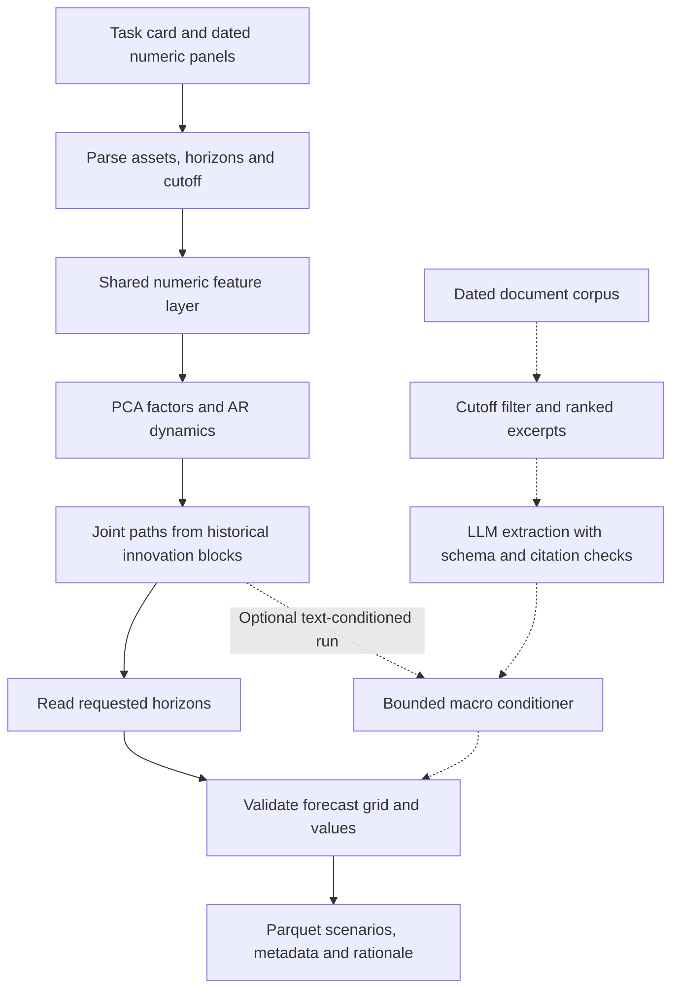

# Off The Tape

**Joint probabilistic forecasting for Treasury yields and FX, with reproducible model evaluation and an optional LLM evidence pipeline.**

Built for Agenthon 2026 Track 2 and extended into a quantitative research project. The system produces 1,000 scenarios across assets and forecast horizons. The research asks which modeling choices improve those distributions—and whether their added complexity is justified.

The strongest finding was a **3.88% reduction in historical holdout loss** from an adaptive-volatility adjustment to PCA, relative to unchanged PCA. A simpler Gaussian alternative remained competitive: its adjusted candidate had 2.02% lower mean loss than adjusted PCA, but the direct comparison did not establish an overall winner. These are local research results, not competition rankings.

## Architecture



The default command follows the numeric path and makes no LLM call. PCA fits each numeric panel separately; mixed rates/FX paths do not learn cross-panel covariance by default. Invalid numeric output triggers an empirical fallback; unavailable or invalid text yields a neutral state. Research volatility variants and the Gaussian comparator run in the evaluation workflow, rather than being enabled by the production command. See [architecture and boundaries](docs/architecture.md).

## Results

The numerical study uses chronological splits: **2005–2017 training (691 cases), 2018–2021 validation (226), and 2022–2024 holdout (156 across 33 origins)**. Each forecast has 1,000 draws and three seeds. The suite covers single yields, yield curves, single FX, FX baskets and mixed rates/FX at 2–12 weekday horizons. Seeds measure Monte Carlo sensitivity; they are not independent market samples.

Loss combines marginal CRPS, joint variogram and tail pinball terms with locally reconstructed expected-error normalization. **Lower is better.**

| Frozen holdout comparison | Control loss | Candidate loss | Relative reduction | Candidate minus control interval | Interpretation |
|---|---:|---:|---:|---|---|
| PCA + 50/50 historical/EWMA variance | 1.35788 | 1.30518 | **3.88%** | [-0.12458, -0.00139] | Passed predefined criterion |
| Gaussian + recent-60 volatility | 1.33251 | 1.27886 | 4.03% | [-0.14703, +0.00310] | Not confirmed |

Intervals above are the predefined 97.5% moving-block bootstrap intervals, adjusted for two comparisons. Each row compares a candidate against its own unchanged model. They do not test PCA against Gaussian.

| Other experiment | Finding | Decision |
|---|---|---|
| Direct adjusted Gaussian vs adjusted PCA | Gaussian mean loss 2.02% lower; 95% paired interval [-0.07753, +0.01326] | Exploratory; no overall winner |
| Historical drift shrinkage | Training-selected zero drift failed to improve validation | Retain full drift |
| Rates/FX dependence adjustments | Negligible validation effects relative to sampling variation | Do not enable tested adjustments |
| Band-SETAR factor dynamics | Validation loss increased 0.134% | Retain AR(1) dynamics |
| Text-conditioned pipeline | Offline lexical proxy did not justify enabling conditioning | Numeric default; LLM uplift unestablished |

PCA's volatility gain was concentrated in 2022; the candidate slightly worsened 2024 loss. The holdout is now consumed. See [results, uncertainty and decisions](docs/results.md) for year breakdowns, experiment provenance and the distinction between research candidates and the published image.

## Try it without market data or API credentials

Use Python 3.13 or newer, from the repository root:

```powershell
python -m pip install -e .
python -m experiments.synthetic_demo
```

The example creates correlated synthetic yield histories, reuses the feature layer in PCA, and runs the base PCA and Gaussian models on the same card. It prints joint scenario shapes and quantiles and writes `reports/synthetic_demo.json`. It needs no scorer, network access, credentials, or downloaded dataset after installation. Synthetic output demonstrates the API; it is not evidence of forecasting accuracy and does not apply research volatility adjustments. Both models receive only observations through the cutoff.

For real panels, agent CLI usage, evaluation dependencies and Docker commands, see the [technical guide](docs/technical_guide.md). Exact historical research runs use the commits and hashes recorded in their protocols; current refactors must not be substituted by rewriting those hashes.

## Engineering and AI work

- **Shared features:** cutoff-aware snapshots, explicit duplicate policies, ordered panel alignment, level/log/return transforms, and historical/recent/EWMA volatility. Immutable outputs and per-snapshot caching support reuse.
- **Forecasting:** coherent scenarios across horizons, PCA/AR(1) with empirical block shocks, a Gaussian benchmark, and an empirical fallback.
- **Evaluation:** outcome-separated historical cards, paired ablations, fixed candidate definitions, hashed inputs, and origin-block uncertainty estimates.
- **LLM integration:** dated document selection, bounded prompt context, structured macro extraction, citation-ID validation, caching and neutral fallback. This is a fixed workflow; no fine-tuning or vector search is claimed.
- **Deployment:** pinned dependencies, a non-root Linux runtime image, output validation and network-isolated public-unit rehearsal.

Recorded verification includes 104/104 official public-unit gate passes before a license-only image rebuild, a worked-exemplar pass on that published image, and 104/104 forecast/fallback parity checks after the feature refactor. The consolidated source suite passed **70 tests**. These checks establish correctness and contract behavior, not forecasting superiority. Details: [container rehearsal](docs/new_image_rehearsal.md), [feature parity](docs/shared_feature_layer.md).

## Limits and next steps

The project does not establish official Final performance, trading profitability, or live-market generalization. The historical suite has only 33 holdout origins, uses weekday target dates with missing-date exclusions, and cannot prove point-in-time vintage availability from cutoff filtering alone. Repeated validation work is exploratory. The text experiment used a lexical proxy; it is not an LLM-quality benchmark.

The source includes the shared feature refactor, but the archived Docker image predates it. Adaptive volatility is a research candidate and SETAR remains an isolated experiment. A controlled architecture study and an actual LLM extraction benchmark are possible extensions; neither is presented as completed.

## Repository map

| Location | Contents |
|---|---|
| [`src/off_the_tape/`](src/off_the_tape/) | Features, numerical models, agent, text pipeline and validators |
| [`experiments/`](experiments/) | Comparisons, ablations, frozen protocol and tracked audit summaries |
| [`tests/`](tests/) | Behavioral, parity, cutoff, inference and evaluation checks |
| [`scripts/`](scripts/) | Public-unit staging, rehearsal and packaging |
| [`docs/`](docs/) | Methods, findings, architecture and technical instructions |

Large input panels, detailed local reports, caches and team claims are excluded from Git. Compact audit summaries and findings are tracked. Licensed under [MIT](LICENSE). Public task definitions and scoring originated in the [Agenthon Track 2 repository](https://github.com/Agenthon-2026/track2-forecasting-public).
