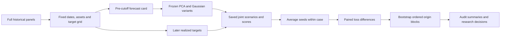

# Architecture and execution boundaries

The system has three related workflows: runtime forecasting, optional text
conditioning, and offline historical research.

## Forecast runtime

`Track2Agent` parses the card's asset-to-panel mapping and target grid, verifies
the requested cutoff, and builds one `FeatureLayer` snapshot per numeric panel.
The agent explicitly filters future rows and keeps the last duplicate to
preserve its existing input policy. Direct feature callers default to rejecting
future rows and duplicates. Missing cells are not silently filled.

PCA transforms yields to changes, FX to log changes and daily simple-return
panels to log1p returns. It uses up to 504 changes, two factors, clipped AR(1)
factor dynamics and paired five-day innovation/residual blocks. Each draw
simulates one path; requested horizons are read from that path. Panel seeds
derive deterministically from the root seed. Separate panel fits do not
estimate mixed rates/FX covariance.

The agent validates scenarios and can replace invalid PCA output with a
deterministic joint empirical fallback with a volatility floor. It checks the
final grid and writes scenarios, metadata and rationale. Default configuration
is numeric-only with 1,000 draws and root seed 2026.

## Optional LLM workflow

An opt-in run filters corpus documents by indexed publication timestamp, ranks
eligible documents using recency/source/topic rules, and supplies bounded
excerpts to a chat-completions endpoint. The prompt requests macro state rather
than future asset prices. Parsing checks schema, bounds and cited document IDs;
these checks do not establish semantic factuality. Validated responses are
cached using document/context/model configuration hashes. Missing or invalid
extraction yields neutral state.

The conditioner adjusts location, volatility, skew, common factors and shock
mixtures within confidence gates and caps. Neutral state preserves base draws.
Invalid conditioned output reverts to base draws. There is no autonomous
tool-planning loop, fine-tuning or embedding retrieval. The proxy experiment
does not measure actual LLM quality.

## Historical research

Outcomes enter scoring, not the model's input card. Split boundaries and exact
target availability determine admission before comparison. Input hashes and
freeze records bind results to their code/data versions. The confirmation
used four arms: base and volatility-adjusted versions of each model. Gaussian
is a native-level daily random walk with trailing-300-row moments and coherent
horizon covariance, not an exact implementation of every official M0 mode.

The shared feature layer serves runtime PCA and diagnostics. Frozen research
code retains historical formulas and hashes. Gaussian retains its own gap
filtering and moment calculations; it is not routed through the feature layer.
Changing a definition requires a new experiment, not rewriting the old freeze.

## Artifact state

| Artifact | State |
|---|---|
| Source runtime | PCA with shared features; numeric-only default |
| Published Docker image | Earlier frozen PCA runtime; predates shared features |
| PCA + EWMA variance blend | Supported historical candidate; not default runtime |
| Gaussian + recent-60 volatility | Research candidate; competitive point estimate |
| Band-SETAR | Isolated negative-result experiment |
| LLM conditioner | Implemented opt-in workflow; LLM forecast uplift unestablished |

See [feature semantics and parity](shared_feature_layer.md) and [results](results.md).
